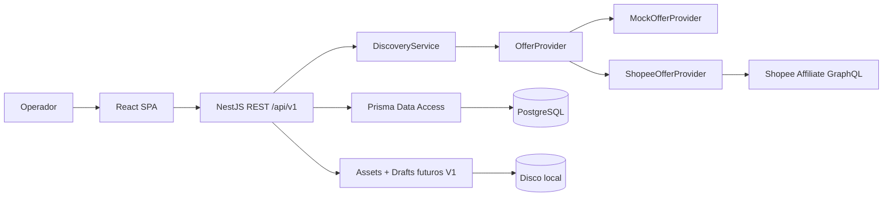

# Arquitetura detalhada — V1

## Escopo da solução

A versão V1 foi desenhada como **monorepo com dois deployables independentes**: aplicação SPA em React e API NestJS. O Postgres é um serviço separado via Docker Compose. O backend concentra todos os segredos, contratos da Shopee e operações mutáveis. O projeto começa em uma estação local com custo de hospedagem zero; migração cloud não exige mudança de stack.

## Componentes

## Dependências do domínio

- **Product Discovery**: consulta, filtros, mapeamento de oferta, paginação.
- **Products**: importação, deduplicação, snapshots, atualização.
- **Affiliate Links**: geração sob demanda, subIDs por campanha e auditoria.
- **Content**: biblioteca licenciada, metadata e armazenamento local.
- **Publications**: rascunhos e registros de publicação manual.
- **Analytics**: métricas separadas por origem (manual vs relatório de afiliados).
- **Integration Status**: status e saúde, nunca segredos.

## Contratos e boundaries

`OfferProvider` define `search` como porta. `MockOfferProvider` implementa dados artificiais para teste; `ShopeeOfferProvider` isola particularidades GraphQL, campos externos, assinatura e erros. Outras plataformas futuras devem implementar nova porta/adaptador sem contaminar React. Não reexportar `@prisma/client` no pacote compartilhado do frontend.

## Decisões arquiteturais

| ADR | Escolha | Fundamentação |
|---|---|---|
| ADR-001 | Monorepo pnpm | Mudanças cross-stack coordenadas e um histórico Git |
| ADR-002 | React + NestJS | TypeScript em ambas camadas, contratos mantidos juntos |
| ADR-003 | Prisma + Postgres | Migrations, unicidade, precisão decimal, custo local baixo |
| ADR-004 | Provider mock | Não bloquear trabalho por aprovação externa |
| ADR-005 | Sem Redis/n8n V1 | Evitar operação de filas prematura |
| ADR-006 | Storage adapter | Troca local→cloud na V3 sem mudar domínio |
| ADR-007 | Publicações manuais | Regras de rede social não asseguram automação |

## Pipeline sugerido

- `PR`: typecheck, unit tests, contract tests, build.
- `main`: integração automática em ambiente local/interno; deploy cloud somente a partir da V3.
- Sem credenciais reais em ações GitHub ou fixtures do repositório.

## Performance

Consulta paginada upstream. Filtro por taxa mínima aplicado no backend com precisão decimal. Páginas podem ter menos itens que o limite após filtrar; não inferir contagem total sem contagem fornecida pela origem. Imagens remotas são conteúdo não confiável. Em V2, cache de curta duração e limitação por chave de API/conta.

## Riscos técnicos

GraphQL sujeito a variação por permissão e versão, quotas não asseguradas, rede local não segura para exposição pública, conteúdo de terceiros pode ter restrições e métricas orgânicas não equivalem a vendas. Cada risco tem gate próprio no `docs/BACKLOG-ACEITE.md`.
