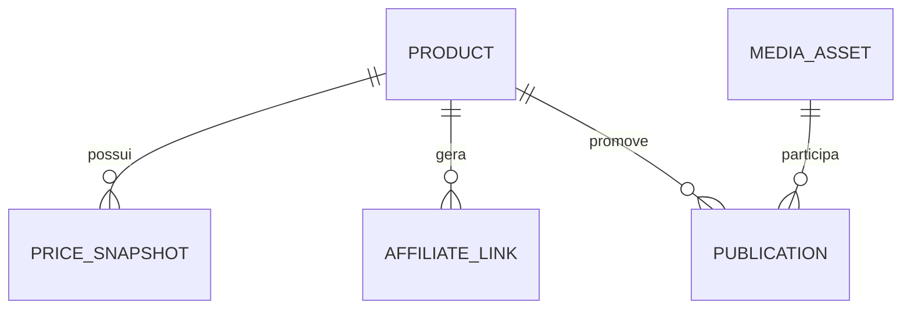

# Persistência e evolução do banco

O arquivo fonte do esquema é [`apps/api/prisma/schema.prisma`](../apps/api/prisma/schema.prisma). As tabelas representam intenção de design: migrations iniciais serão geradas pelo Prisma em ambiente local após instalação das dependências.

## Modelo



**Product** — marketplace, `shopId`, `itemId`, nome, URL, price, priceMax, commissionRate, estimatedCommission, rating, sales, syncedAt. Chave única composta evita duplicatas.

**PriceSnapshot** — histórico com timestamp; decisão de granularidade (por mudança ou por coleta diária) deve ser explícita para não inflar banco com registros idênticos.

**AffiliateLink** — URL curta com canal/campanha/subIds; não armazenar credenciais.

**MediaAsset** — caminho da mídia, origem, hash, tipo de licença e evidência verificável de uso comercial.

**Publication** — canal, draft, ready, publicado manualmente, arquivado, URL externa e data.

## Tipos e constraints

- `Decimal(12,2)` em BRL, `Decimal(10,6)` para taxas. Dados da API devem ser interpretados pela documentação específica do fornecedor.
- `shopId/itemId` strings: APIs podem expor IDs que ultrapassam `Number.MAX_SAFE_INTEGER` no JS.
- Datas armazenadas UTC. Interface apresenta o fuso do operador.
- Índices para taxa, data de sync, status e chave composta.
- Depois da homologação, agregar CHECK constraints para limites de comissão 0..1, rating 0..5, preços >=0.

## Migrations

```bash
pnpm --filter @afflix/api prisma:generate
pnpm --filter @afflix/api prisma:migrate
```

Revisar SQL gerado. Nunca usar `db push` como estratégia permanente de produção. Backups lógicos e teste de restauração obrigatórios antes de migrar dados reais ou disponibilizar API remotamente.

## Retenção

Produtos marcados como arquivados em vez de removidos quando referenciados por campanhas; snapshots podem ter política de retenção controlada, relatórios financeiros preservados por prazos legais aplicáveis. Mídia e backups não entram no Git.
